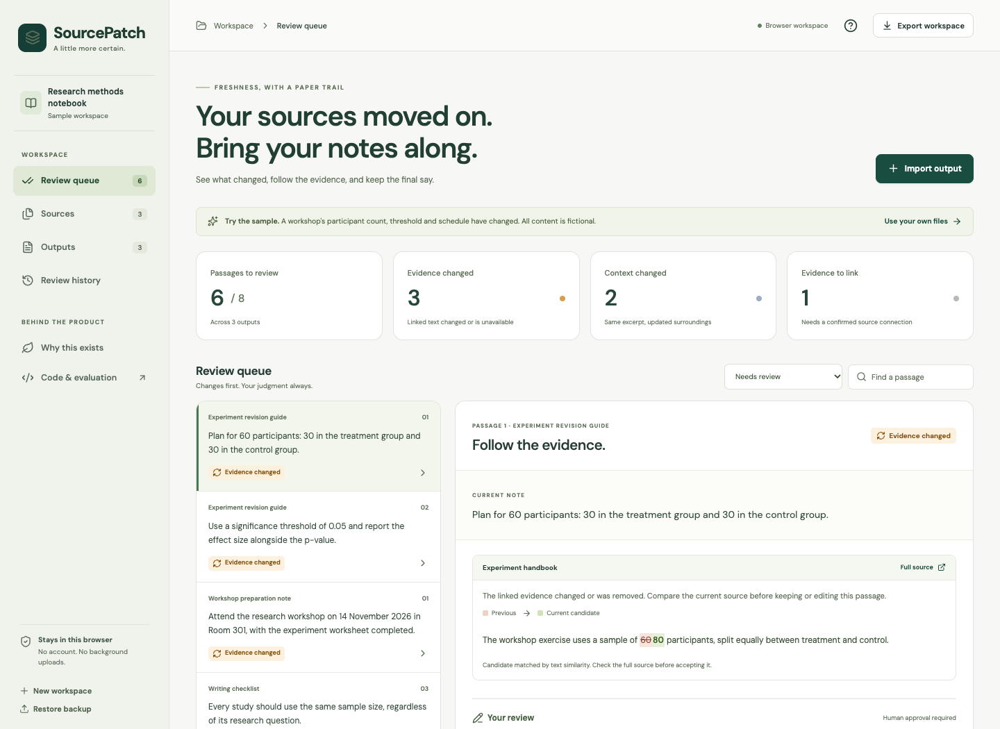

# SourcePatch

**Your sources moved on. Bring your notes along.**

A local-first freshness review companion for exported NotebookLM notes. Track which passages depend on changed source material, inspect the evidence, and approve corrections with a versioned review history.

[Open the live demo](https://guhanp09.github.io/sourcepatch/) · [Product case study](docs/CASE_STUDY.md) · [Research shortlist](docs/PROJECT_SHORTLIST.md) · [Evaluation](evaluation/RESULTS.md)



## Why it exists

Google's [notebook documentation](https://support.google.com/gemininotebook/answer/16215270?hl=en) explains that source changes do not update previously generated Studio outputs. SourcePatch explores the step that follows: maintaining the exported notes people continue to use.

The subtle problem is **changed context**. A cited sentence can survive verbatim while a new exception elsewhere changes what it means. SourcePatch distinguishes that case from a changed citation or an unchanged source.

This is an independent companion prototype, not a native NotebookLM feature, direct Google integration or Google-endorsed product. The documentation currently uses the Gemini Notebook name for the notebook product.

## Try it in a minute

1. Open the [demo](https://guhanp09.github.io/sourcepatch/). The sample is fictional and needs no account.
2. Select the passage that still says **60 participants**. The current source says **80**.
3. Update the note to 80 total and 40 per group, inspect the current evidence, check the review confirmation and save.
4. Inspect the random-assignment passage. Its excerpt is unchanged, but the source gained a limitation. Open the context diff.
5. Open **Outputs** to export a note, or **Review history** to inspect the decision and source version.

To use your own material, start a new workspace. Add the original source version, import the note, confirm its evidence links, then add a source revision. Text/Markdown files and pasted text are supported. PDFs, automatic Drive synchronization and native notebook modification are not included.

## What is implemented

- Immutable source snapshots with SHA-256 content fingerprints.
- Passage-level evidence links and clearly unconfirmed TF-IDF suggestions.
- Five review states: changed evidence, changed context, unlinked evidence, unavailable source and no source change.
- Before/after word diffs, full source history and explicit human approval.
- Reviews that reopen when later source revisions affect their evidence.
- Markdown exports that retain unresolved review status, plus validated JSON backup/restore.
- Local persistence with visible quota errors, recovery of corrupt stored data and cross-tab conflict detection.
- Responsive layouts, keyboard-accessible dialogs and automated accessibility checks.
- Optional local Gemini review suggestions with structured output and exact-quote validation; no automatic edits.

## Run locally

Node.js **22.12+** is required.

```bash
npm ci
npm run dev
```

Open the local URL printed by Vite. No secrets or cloud configuration are required.

```bash
npm run check       # Unit/integration tests, fixture evaluation, type check and build
npm run test:e2e    # Chromium workflow and accessibility checks
npm run preview    # Serve the production build locally
```

The browser test configuration uses installed Chrome locally. For a portable Chromium run, install Playwright Chromium and run with `CI=1` after stopping any existing server on port 4173:

```bash
npx playwright install chromium
CI=1 npm run test:e2e
```

Dependencies are version-pinned in `package.json` and `package-lock.json`. CI runs checks and browser tests before GitHub Pages deployment.

## Optional Gemini assistance

The browser app does **not** need a key and does **not** send your documents to Gemini. A separate local command can suggest revisions for an exported workspace.

1. Copy `.env.example` to `.env` locally and set `GEMINI_API_KEY` and a currently available `GEMINI_MODEL` supporting structured output. Both `.env` and `private/` are Git-ignored.
2. Export your workspace from the app.
3. Run the explicit review command:

```bash
npm run review:gemini -- path/to/workspace.sourcepatch.json private/review.md --limit 4
```

This command sends selected passages and associated current source text to Google's API. Provider charges and data policies apply to your configured account. It writes a new, unapproved Markdown suggestion file, never overwrites an existing output, and never edits the workspace. Review each suggestion and its exact source excerpts before entering it in the app.

**Validation status:** provider transport and response validation are covered by mocked tests. No live Gemini request or semantic-quality evaluation was performed in the build environment because no API key was configured. No API secret is included in the repository or demo.

## Evaluation, with its limits

The evaluation contains **26 hand-authored revision scenarios** covering quantities, dates, negation, mathematical operators, deleted evidence, context exceptions, missing sources, unconfirmed links, unchanged sources and unrelated changes.

| Policy | Review needs missed | Unnecessary alerts |
| --- | ---: | ---: |
| Leave output unchanged | 20 | 0 |
| Invalidate all outputs on any source change | 0 | 2 |
| Check only the cited excerpt | 6 | 0 |
| SourcePatch | 0 | 0 |

These are deterministic policy regression results on fixtures authored alongside the implementation. They are **not** real-world accuracy, held-out model results, user time savings or business impact. SourcePatch can still over-alert on harmless edits, miss semantic problems in unchanged sources, or suggest the wrong evidence. See [the complete results and assumptions](evaluation/RESULTS.md) and [the proposed user study](docs/RESEARCH_PLAN.md).

The initial release includes **50 unit/integration tests** and **19 browser tests**, including automated WCAG checks. Automated accessibility testing is partial; it does not replace testing with assistive-technology users.

## Product decisions and Google APM relevance

The project demonstrates a reviewable product lifecycle: primary-source problem research, existing-feature checks, user-segment selection, alternatives, requirements, technical delivery, measurement and release tradeoffs. These map to the [Google APM role's stated responsibilities](https://www.google.com/about/careers/applications/jobs/results/101007950268506822-associate-product-manager-university-graduate-2027-start).

| Artifact | What a reviewer can inspect |
| --- | --- |
| [Research shortlist](docs/PROJECT_SHORTLIST.md) | Five Google-oriented ideas, primary sources, selection rationale and integration constraints |
| [Product brief](docs/PRODUCT.md) | Problem, audience, scope, alternatives, priorities and metrics |
| [Architecture](docs/ARCHITECTURE.md) | Data model, change policy, privacy and optional model boundary |
| [Evaluation](evaluation/RESULTS.md) | Reproducible cases, baselines, outcomes and limitations |
| [Research plan](docs/RESEARCH_PLAN.md) | Proposed discovery, comparative study and stop criteria |
| [Case study](docs/CASE_STUDY.md) | What was built, why, and what remains unproven |
| [Demo script](docs/DEMO.md) | A concise technical/product presentation |

No customer interviews, adoption, retention or cross-functional Google experience are claimed. The next question is whether linking evidence plus reviewing changes reduces total effort while preventing consequential omissions.

## Data handling and limits

Documents stay in local browser storage during normal app use. There is no analytics SDK, document-upload service or third-party font request. Hosting still involves ordinary asset requests. Clearing site data or changing browser profiles can remove access to the workspace; export a backup to preserve it. Local storage is not encrypted cloud backup.

The prototype supports up to 20 sources, 30 revisions per source, 20 outputs and 100 passages per output, subject to a 1.8 MB workspace save limit. Source text is capped at 40,000 characters. A fingerprint checks consistency, not authenticity. The review history is inspectable local data, not a tamper-proof audit service.

## Authorship

Created by **Guhan Purushothaman**, with substantial AI assistance for research, implementation, testing and documentation. Examples are fictional; evaluation fixtures are authored. The full implementation and decision record are available for inspection.

MIT licensed. Google, NotebookLM and Gemini are trademarks of their respective owners. This project is independent and unaffiliated.
