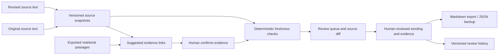

# Architecture and data handling

## Runtime boundaries

The deployed app is static React + TypeScript, built with Vite. There is no application server, analytics service, account system or document upload endpoint. Fonts are bundled locally. Browser tests check that the normal review workflow sends no requests to third-party origins. The host still receives ordinary page/asset requests, and the optional CLI has a separate network boundary.

## Data model

- Workspace: schema version, name, sample flag, sources, outputs and audit entries.
- Source: stable identifier, title, archived flag and an ordered set of snapshots.
- Snapshot: identifier, creation timestamp, normalized text and SHA-256 fingerprint.
- Passage: text and zero or more evidence links.
- Evidence: source identifier, snapshot identifier, exact excerpt and confirmation state.
- Review entry: before/after wording, reasoning, timestamp and evidence used.

The fingerprint detects inconsistent backup contents. It is not a digital signature, proof of authorship, trusted timestamp, or tamper-proof audit log. A person controlling a backup can change it and recompute hashes.

## Change policy

Text normalization converts CRLF to LF, applies Unicode NFC and trims outer whitespace. Internal indentation, punctuation, numbers and operators remain significant. This avoids hiding changes such as `[0,1]` → `(0,1)` or different code indentation.

The engine first checks source availability and link validity, then confirmation. Identical source content is current. If the complete source differs but the linked quote survives, it becomes context review. If the quote no longer survives, it becomes evidence changed. No similarity threshold can produce a verified state.

Evidence suggestions use TF-IDF cosine similarity on Unicode letter/number tokens. The threshold is a convenience heuristic, not calibrated confidence. Suggested updated excerpts are shown as candidates, and the reviewer can choose another paragraph or source. Semantic equivalence and truth remain outside the deterministic engine.

## Imports and persistence

JSON imports validate a strict Zod schema, byte-size limits, uniqueness of identifiers, source digests and evidence references before replacing state. Text/Markdown is rendered as text in React rather than injected HTML. No markdown scripts or embedded images execute.

Local storage failure produces a visible warning and keeps the working copy in memory for export. Corrupt stored data is retained for download; it is not overwritten with a sample. Cross-tab changes trigger a reload warning and block further edits in the older tab. This is conflict detection for a single-user prototype, not a concurrent collaboration protocol.

Archiving retains all source snapshots and marks dependent passages unavailable. Restoration is reversible. Review history preserves prior wording; backups can restore full state. The app has no cloud synchronization or automatic backup.

## Optional Gemini adapter

`npm run review:gemini -- workspace.json private/review.md` reads an exported workspace locally. It takes up to ten pending passages, associated current source text and their prior evidence. Only an explicit invocation with `GEMINI_API_KEY` and `GEMINI_MODEL` can send that material to Google's API. Provider charges and data handling depend on the configured account.

The adapter uses the documented [generateContent API](https://ai.google.dev/api/generate-content?hl=en) and structured JSON output. It treats document contents as untrusted data, has no tools or URL-fetching ability, rejects missing/duplicate passage IDs and invented quotations, and rejects incomplete provider responses. It writes an unapproved Markdown suggestion file with source fingerprints and never modifies the workspace. A valid schema and exact quotation are necessary checks, not proof of correct reasoning.

The key is read from the local process environment, never from `VITE_*` variables or browser storage. `.env` and `private/` are ignored by Git. The published app has no Gemini key and no automatic API calls.

## Files worth reviewing

- `src/core/engine.ts`: change policy and citation suggestions.
- `src/core/model.ts`: schema, fingerprints and validated import.
- `src/core/actions.ts`: version-preserving mutations and human review.
- `src/core/gemini.ts`: optional provider boundary and response validation.
- `tests/`: lifecycle, integrity, accessibility and browser workflows.
- `evaluation/`: fixtures, baselines and reproducible results.

## Known engineering limits

No semantic conflict resolution, document permission enforcement, rich document parsing, storage encryption, multi-user collaboration, continuous source watching or background jobs. Exact quotation matching can over-alert on harmless formatting changes. The prototype limits document sizes to keep synchronous diffing, storage and local review responsive. These are explicit boundaries rather than simulated integrations.
